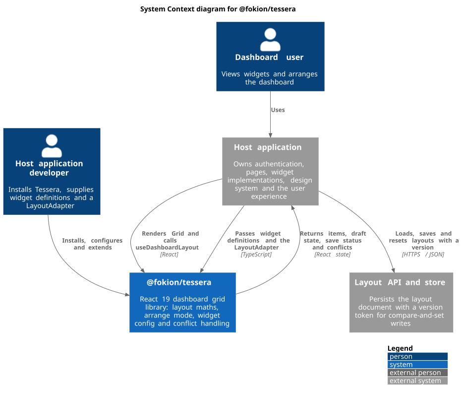
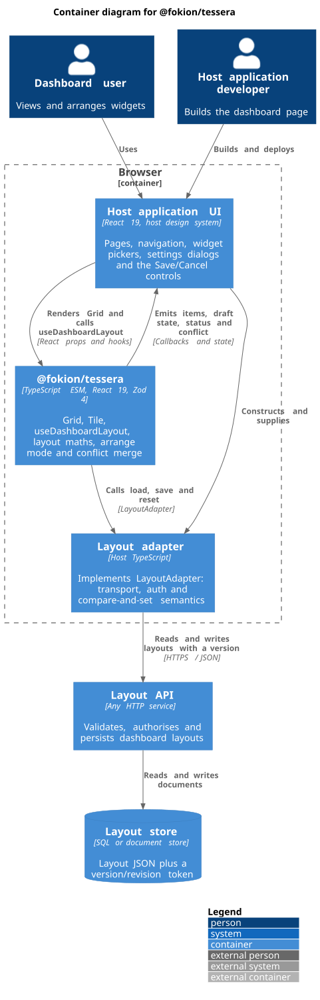
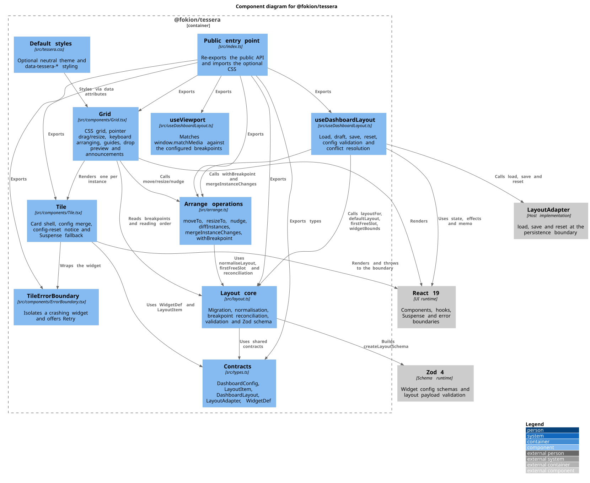
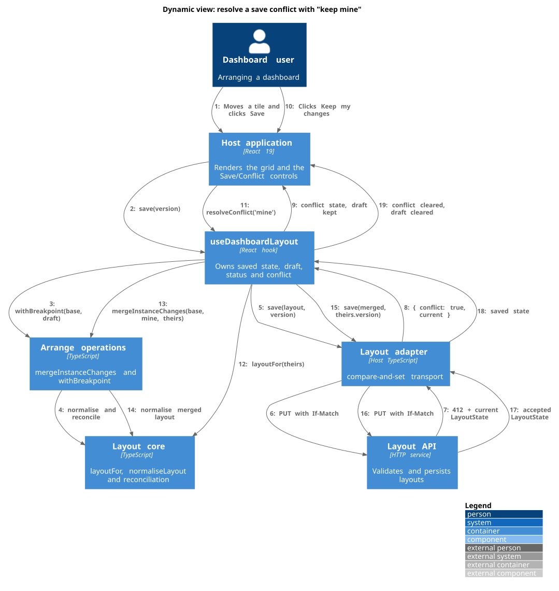
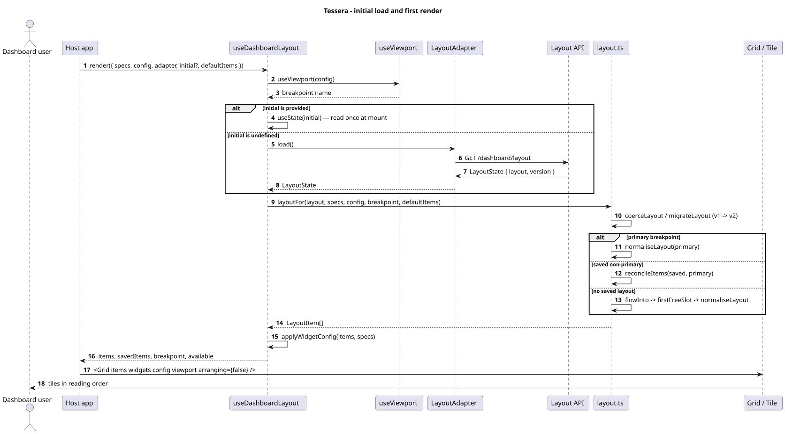
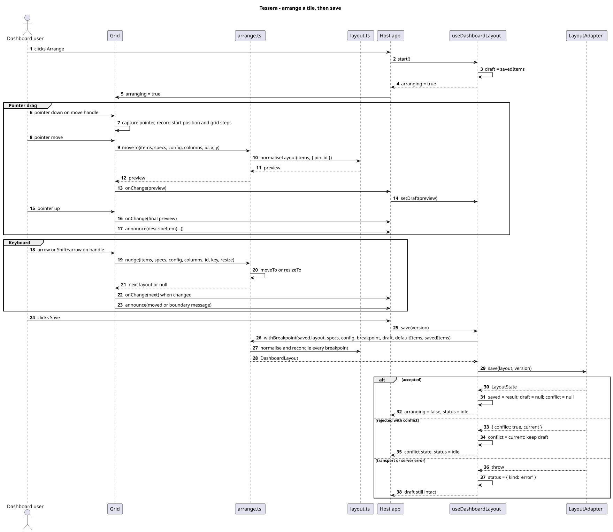
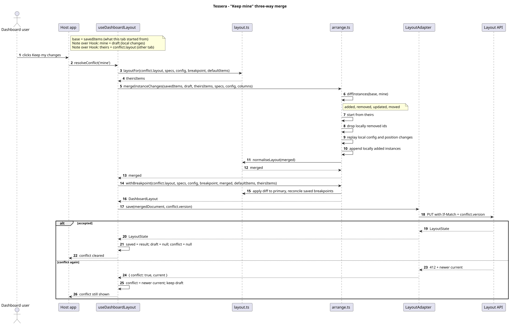
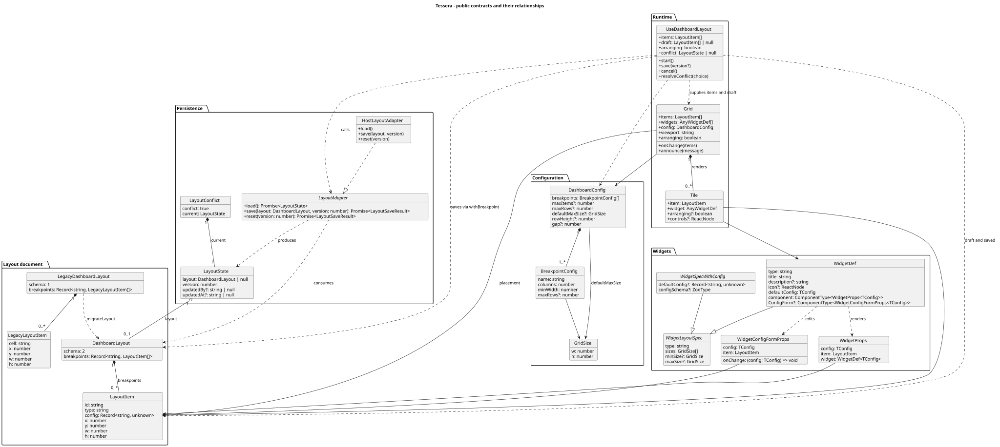
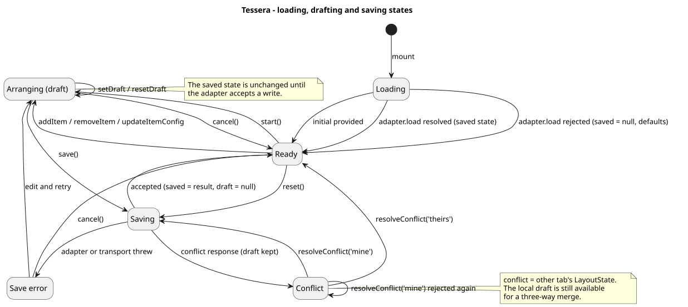
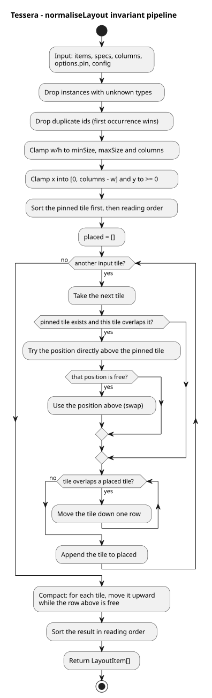

# Tessera documentation

`@fokion/tessera` is a configurable, unstyled dashboard grid for React 19. It
owns the layout maths, arrange mode, per-widget configuration and conflict
handling; the host application supplies widgets and persistence.

This directory is the long-form documentation. The root
[`README.md`](../README.md) is the short overview and quick-start.

## Reading paths

| If you want to… | Read |
| --- | --- |
| Install and render a first dashboard | [Getting started](./getting-started.md) |
| Understand instances, breakpoints, drafts and conflicts | [Concepts](./concepts.md) |
| Look up an export, prop or option | [API reference](./api-reference.md) |
| Understand how the package is built and why | [Architecture](./architecture.md) |
| Run tests, build the package or render diagrams | [Development](./development.md) |
| See the system from the outside in | [C4 model](./c4/README.md) |
| See interaction and algorithm diagrams | [PlantUML diagrams](./plantuml/README.md) |

## Architecture views

The architecture is documented with two complementary notations:

- **C4 model** ([`c4/`](./c4/README.md)) — context, container, component and a
  dynamic save-conflict view. These answer *who uses the system* and *which
  parts talk to which*.
- **PlantUML** ([`plantuml/`](./plantuml/README.md)) — sequence, class, state
  and activity diagrams. These answer *in what order* and *with what data*.

The `.puml` files are the source of truth. Rendered SVGs live in
[`diagrams/`](./diagrams/) and are generated from them.

## Rendered views

| View | Diagram |
| --- | --- |
| C4 context | <a href="./diagrams/Tessera-C1-Context.svg"></a> |
| C4 container | <a href="./diagrams/Tessera-C2-Container.svg"></a> |
| C4 component | <a href="./diagrams/Tessera-C3-Component.svg"></a> |
| C4 dynamic conflict | <a href="./diagrams/Tessera-C4-Dynamic-Save-Conflict.svg"></a> |
| Initial load | <a href="./diagrams/Tessera-Sequence-Load.svg"></a> |
| Arrange and save | <a href="./diagrams/Tessera-Sequence-Arrange-Save.svg"></a> |
| Conflict merge | <a href="./diagrams/Tessera-Sequence-Conflict-Merge.svg"></a> |
| Class model | <a href="./diagrams/Tessera-Class-Model.svg"></a> |
| Draft states | <a href="./diagrams/Tessera-State-Draft.svg"></a> |
| Normalisation activity | <a href="./diagrams/Tessera-Activity-Normalise.svg"></a> |

## Diagram conventions

- C4 diagrams use the [C4-PlantUML](https://github.com/plantuml-stdlib/C4-PlantUML)
  standard library, included with PlantUML as `!include <C4/C4_…>`.
- Every diagram has an `@startuml <name>` / `@enduml` block and a unique name so
  it can be rendered on its own.
- Diagrams deliberately show the package boundary. The host application and
  its layout API are external systems, not part of Tessera.

## Rendering the diagrams

With Docker (no local PlantUML install required):

```bash
pnpm docs:diagrams
```

With a local PlantUML installation:

```bash
plantuml -tsvg -o docs/diagrams docs/c4/*.puml docs/plantuml/*.puml
```

The VS Code [PlantUML extension](https://marketplace.visualstudio.com/items?itemName=jebbs.plantuml)
and IntelliJ's PlantUML integration render the files with a preview shortcut.

`pnpm docs:check` validates every diagram without writing output; CI runs the
same check on each push.
